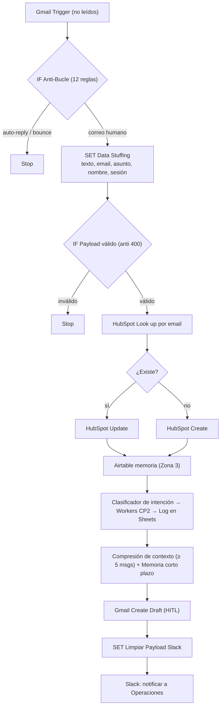

# Checkpoint 4 — Sincronización del Cerebro Agéntico con Ecosistemas de Negocio

Orquestador multi-agente (n8n Cloud) que evoluciona el **Manager Orquestador del CP3** (triaje semántico + workers desacoplados + memoria dual) y lo conecta a tres herramientas reales de la organización: **Gmail** (casilla de soporte), **HubSpot** (CRM) y **Slack** (equipo de operaciones), siempre por **OAuth2** y con barreras preventivas no-code.

- Archivo: [`checkpoint4_martin_olivares.json`](./checkpoint4_martin_olivares.json) (importable desde *Workflows → Import from file*).
- Stack: n8n Cloud · Gmail · HubSpot · Slack · Airtable (memoria) · Google Sheets (observabilidad) · Google Gemini.

## 1. Conexiones activas (Credentials)


*Captura de la sección **Credentials** de n8n (menú lateral → Overview → pestaña Credentials) con las 3 conexiones OAuth2 activas: HubSpot, Gmail y Slack.*

| Herramienta | Credencial n8n | Autenticación | Operaciones usadas | Permisos mínimos necesarios |
|---|---|---|---|---|
| Gmail | `gmailOAuth2` | OAuth2 | Trigger (lectura de no leídos) · **Create Draft** | `gmail.readonly` + `gmail.compose`. **No se usa Send**, no hace falta `gmail.send` |
| HubSpot | `hubspotOAuth2Api` | OAuth2 | Search (lectura) · Create/Update contacto (escritura) | `crm.objects.contacts.read` + `crm.objects.contacts.write` |
| Slack | `slackOAuth2Api` | OAuth2 | Post message en un canal | `chat:write` (+ `channels:read` para listar canales; el bot debe estar invitado al canal) |
| Airtable | `airtableOAuth2Api` | OAuth2 | Search / Create / Update (tabla *Memoria*) | `data.records:read` + `data.records:write` sobre una sola base |
| Google Sheets | `googleSheetsOAuth2Api` | OAuth2 | Append (hoja *Log*) | Acceso solo al documento de logs |

Mínimo privilegio en el flujo: la búsqueda en HubSpot pide solo `email`, `firstname` y `lastname`; el Create envía solo campos ya validados; ningún nodo de Gmail puede enviar mails. Si la credencial es gestionada por n8n, el listado final de scopes lo define n8n; con una app OAuth propia usar únicamente los de la tabla.

## 2. Arquitectura (Modelo de 4 Capas)

1. **Herramientas:** Gmail (canal), HubSpot (fuente única de verdad del cliente), Slack (equipo), Airtable (memoria).
2. **Integración:** conectores nativos de n8n con OAuth2, sin API keys expuestas en el JSON.
3. **Proceso:** triaje por LLM (INVENTARIO / POLITICAS / otro), Workers desacoplados vía *Execute Workflow*, memoria dual y compresión de contexto (≥ 5 mensajes).
4. **Gobernanza:** anti-bucle, anti-409, anti-400, payloads limpios y *Human-in-the-loop* en la salida.



## 3. Cumplimiento de los lineamientos (paso a paso)

| # | Requisito | Dónde se cumple |
|---|---|---|
| 1 | ≥ 3 conectores nativos (CRM, Gmail, Slack) | `HubSpot: *`, `Gmail Trigger (Soporte)`, `Gmail: Create Draft (HITL)`, `Slack: Notificar Operaciones` |
| 2 | Autenticación OAuth2 con semáforo en verde | Sección 1 + captura |
| 3 | Lectura/escritura acotada (mínimo privilegio) | Search con 3 propiedades; Create/Update solo con campos validados |
| 4 | IF inmediatamente después del trigger | `IF: Filtro Anti-Bucle Definitivo` |
| 5 | Condición determinista de auto-respuestas | Asunto: *Auto-reply, Autoreply, Automatic reply, Out of office, Undeliverable, Delivery Status Notification, Respuesta automática* · Remitente: *no-reply@, noreply@, mailer-daemon@* · Cabecera `Auto-Submitted` (`auto-replied`, `auto-generated`). Insensible a mayúsculas |
| 6 | Look up antes del Create (anti-409) | `HubSpot: Buscar Contacto` → `IF: ¿Existe en CRM?` → `Actualizar` / `Crear` |
| 7 | Salida exclusivamente **Create Draft** (HITL) | `Gmail: Create Draft (HITL)`; no existe ningún nodo Send |
| 8 | Set/filtro antes de Slack | `SET: Limpiar Payload Slack` (solo texto plano de 5 líneas) |
| 9 | Test de regresión manual | Sección 5 (pruebas con correos reales y capturas de evidencia) |

**Los 4 nodos de la rúbrica**

| Nodo | Implementación | Previene |
|---|---|---|
| ① IF anti auto-reply | `IF: Filtro Anti-Bucle Definitivo` | Bucle infinito |
| ② Look up antes de Create | `HubSpot: Buscar Contacto` (+ *Always Output Data*) | Error 409 |
| ③ Create Draft | `Gmail: Create Draft (HITL)` | Envío sin aprobación humana |
| ④ Set de limpieza | `SET: Data Stuffing` + `IF: Payload Válido (Anti 400)` + `SET: Limpiar Payload Slack` | Error 400 y payloads pesados |

## 4. Guardrails y decisiones de diseño

- **Anti-bucle:** el remitente se evalúa sobre `from.text` (con `simple:false` Gmail entrega `from` como objeto); la comparación es insensible a mayúsculas, así "Out of Office" y "Automatic reply" (Outlook) también se cortan.
- **Anti Data Stuffing:** solo viajan `texto_original` (texto plano, máx. 4000 caracteres; si el mail es solo HTML se limpian las etiquetas), `email`, `asunto`, `nombre` y `user_session_id` (threadId). Sin adjuntos (`downloadAttachments: false`).
- **Anti-400:** el email debe cumplir una regex estricta (sin comillas, que además evita romper la fórmula de búsqueda en Airtable) y el cuerpo no puede estar vacío. Un mail sin asunto ya no rompe el flujo.
- **Anti-409:** Look up por email; si existe → Update (solo el campo `message`, sin pisar nombre); si no → Create (nombre, apellido, `lifecyclestage = lead`).
- **HITL:** el cliente nunca recibe nada sin aprobación: el resultado queda como borrador en el mismo hilo, con saludo, cuerpo (escapado contra HTML), cierre y firma corporativa. Las consultas no clasificadas se escalan con aviso 🚨 en Slack (reemplaza al envío de mail al supervisor).
- **Slack:** el asunto se escapa (`& < >`) para impedir menciones masivas tipo `<!channel>` desde un correo externo.
- **Resiliencia:** reintentos (3) en HubSpot, Gmail Draft y Slack; el fallo de Slack no frena el flujo.

## 5. Test de regresión manual

Con el workflow abierto, hacer **Execute Workflow** (o **Test step** nodo por nodo) y enviar a la casilla de soporte, desde otra cuenta, estos correos no leídos:

| Correo de prueba | Resultado esperado |
|---|---|
| Asunto "Consulta de stock Tóner HP 85A" | Pasa todo el flujo: contacto en HubSpot, ficha en Airtable, fila en Sheets, **borrador** en Gmail y mensaje en Slack |
| Asunto "Out of Office AutoReply: prueba" | Corta en `Stop (Auto-reply)` (regla de asunto, insensible a mayúsculas) |
| Asunto "Automatic reply: prueba" | Corta en `Stop (Auto-reply)` |
| El primero, enviado de nuevo | El Look up enruta por **Update** (no duplica el contacto en HubSpot) |

Las reglas de remitente (`no-reply@`) y de cabecera (`Auto-Submitted`) se pueden simular fijando (*Pin data*) un resultado en el Gmail Trigger y editando los campos `from.text` o `headers`.

Evidencias (opcional): capturas del workflow completo y de una ejecución exitosa en la carpeta [`evidencia/`](./evidencia).

> ⚠️ Las pruebas escriben datos reales (HubSpot, Airtable, Sheets, borrador y Slack). Borrar los datos de prueba al terminar.

## 6. Requisitos previos del entorno

- Sub-workflows **CP2 - Worker 1 Inventario** y **CP2 - Worker 2 Políticas** creados en la misma instancia (se invocan por ID desde *Execute Workflow*). Sus JSON se pueden subir a la carpeta `workers/` para reproducir el proyecto en otra instancia.
- Airtable, tabla **Memoria**: `Email`, `Session_ID`, `Nombre`, `Empresa`, `Nivel_Urgencia`, `Estado_Caso`, `Mensajes`, `Ultimo_Worker`, `Fecha_Actualizacion`, `Asunto_Principal`, `Puntos_Clave`, `Accion_Requerida`.
- Google Sheets, hoja **Log**, encabezados: `fecha`, `worker`, `intent`, `status`, `respuesta`.
- Slack: el bot de la app debe estar invitado al canal de operaciones.

## 7. Cambios respecto al CP3

- Entrada: *Chat Trigger* → **Gmail Trigger** + IF anti-bucle + Set anti Data Stuffing + IF anti-400.
- Nuevo bloque CRM (**HubSpot**: Look up → Update/Create) antes de la memoria.
- Salida: respuesta de chat → **Create Draft (HITL)** + Set + **Slack**.
- Eliminado el nodo Gmail *Send* de alerta al supervisor (incluía un email personal fijo); ahora el aviso va por Slack.
- Se mantienen sin cambios: memoria dual (Airtable + LangChain), compresión de contexto, workers desacoplados y log en Sheets.

## 8. Seguridad

El JSON **no contiene secretos**: solo IDs de credenciales, de la base y tabla de Airtable, del documento de Google Sheets, del canal de Slack y de los sub-workflows. Por sí solos esos IDs no dan acceso; se verificó que el Google Sheet esté en acceso *Restringido* y que la base de Airtable no tenga *Compartir en la web* activo. Se eliminaron los metadatos de instancia (`instanceId`, `id`, `versionId`) y el email personal que tenía el CP3.

## 9. Estructura del repositorio

```
checkpoint4_martin_olivares.json   # workflow n8n
README.md
credentials.png                    # captura de Credentials (3 conexiones activas)
evidencia/                         # (opcional) capturas del workflow y de ejecuciones
workers/                           # (opcional) JSON de los 2 sub-workflows CP2
```
